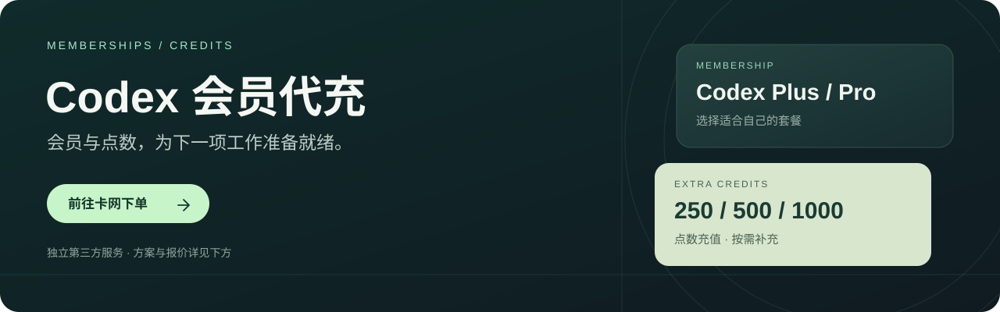

  

  <a href="https://wzyp.cn/shop/VR2QADTP"><strong>进入卡网下单 ↗</strong></a>
  &nbsp; · &nbsp;
  <a href="docs/plus-subscription-guide.md">开通与付款说明</a>
  &nbsp; · &nbsp;
  <a href="docs/codex-daily-guide.md">Codex 使用指南</a>

> **客服报价 · 2026-11-03** 
> 客服下单无手续费；卡网下单请核对结算总额。

## 01 · Codex 套餐

<table width="100%">
  <tr>
    <td width="33%" valign="top">
      <strong>Codex Plus</strong>
      <h2>¥137</h2>
      <a href="https://wzyp.cn/shop/VR2QADTP">卡网下单 ↗</a>
        
    </td>
    <td width="33%" valign="top">
      <strong>Pro 5X</strong>
      <h2>¥717</h2>
      <a href="https://wzyp.cn/shop/VR2QADTP">卡网下单 ↗</a>
        
    </td>
    <td width="33%" valign="top">
      <strong>Pro 10X</strong>
      <h2>¥1190</h2>
      <a href="https://wzyp.cn/shop/VR2QADTP">卡网下单 ↗</a>
        
    </td>
  </tr>
</table>

## 02 · Codex 点数充值

<table width="100%">
  <tr>
    <td width="33%" valign="top">
      <strong>250 点数</strong>
      <h2>¥85</h2>
      <a href="https://wzyp.cn/shop/VR2QADTP">卡网下单 ↗</a>
        
    </td>
    <td width="33%" valign="top">
      <strong>500 点数</strong>
      <h2>¥165</h2>
      <a href="https://wzyp.cn/shop/VR2QADTP">卡网下单 ↗</a>
        
    </td>
    <td width="33%" valign="top">
      <strong>1000 点数</strong>
      <h2>¥300</h2>
      <a href="https://wzyp.cn/shop/VR2QADTP">卡网下单 ↗</a>
        
    </td>
  </tr>
</table>

以上金额由维护者提供，商品名称沿用报价。**套餐周期、点数有效期、账号条件与售后规则，请在下单前确认。**

## 03 · 下单与使用

1. **选方案** — 进入[卡网](https://wzyp.cn/shop/VR2QADTP)，核对实际商品与结算总额。
2. **按订单操作** — 阅读充值要求、服务周期和售后说明，按订单页指引完成操作。
3. **核对权益** — 回到目标账号检查套餐或点数，保存订单；开始使用可看 [Codex 指南](docs/codex-daily-guide.md)。

---

**下单前请了解**：本文与所链接店铺为第三方服务，与 OpenAI 不存在官方代理、授权或背书关系。服务地区与账号条件仍需满足[官方要求](https://help.openai.com/en/articles/7947663-chatgpt-supported-countries)。账号密码、登录验证码、登录令牌及 API Key 均属敏感信息，勿向不可信方提供。

付款失败、会员未到账或已有订阅：[查看问题排查](docs/plus-subscription-guide.md#付款与会员问题排查)。
